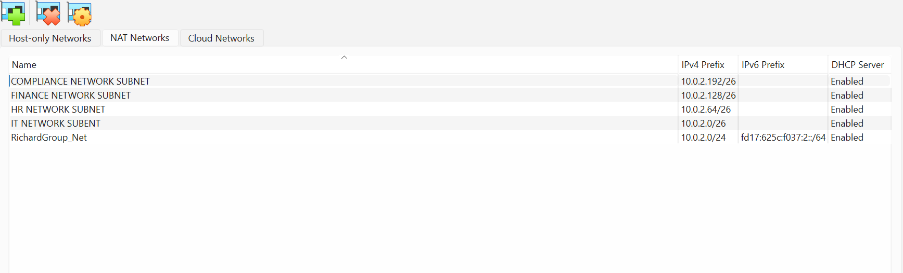
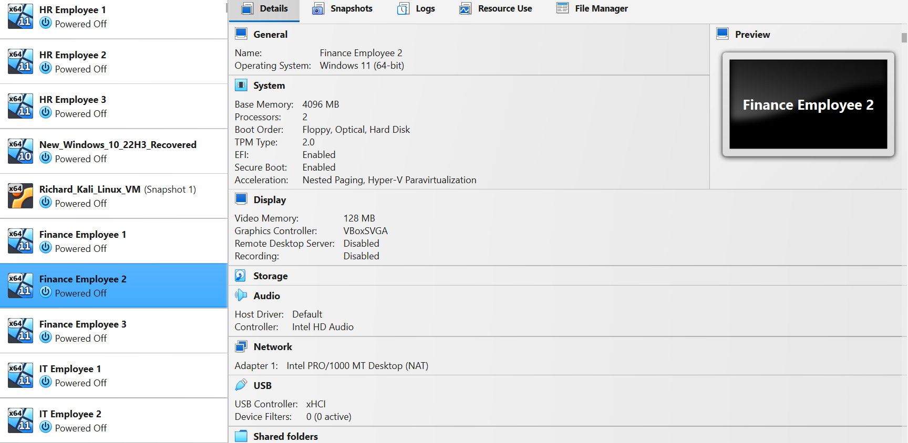
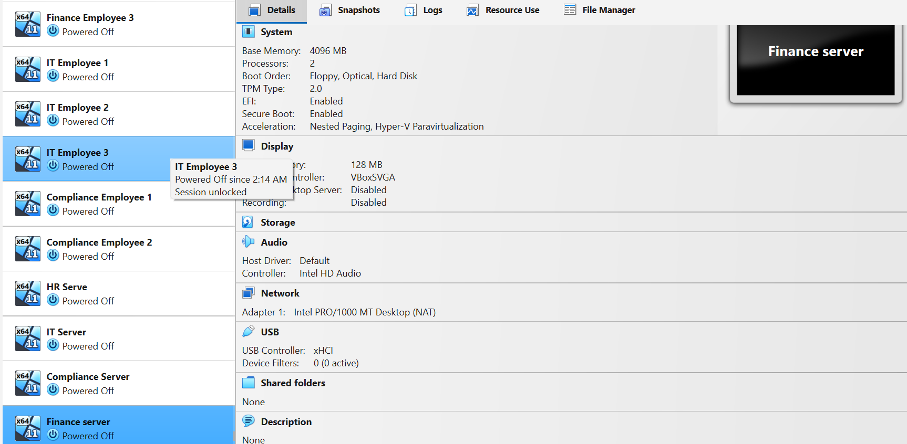
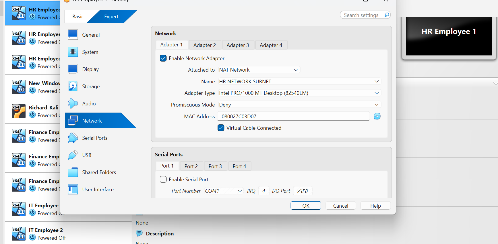

# NETWOTK-SEGMENTATION
### Implementing Subnetting in the Multi VM Cybersecurity Lab

# Network Segmentation Lab — VirtualBox

## Project Overview

This project demonstrates the design and configuration of a departmental network segmentation lab using Oracle VirtualBox.

The lab represents four organizational departments—Human Resources (HR), Finance, Information Technology (IT), and Compliance. Each department has a dedicated VirtualBox NAT Network and an IPv4 subnet to establish separate logical network segments.

The project focuses on network design, IPv4 subnetting, DHCP configuration, virtual network management, and the principles of reducing unnecessary communication between departments.

**Project status:** Network configuration established; interdepartmental traffic isolation testing remains outstanding.

## Objectives

- Design separate network segments for four organizational departments.
- Configure departmental NAT Networks in VirtualBox.
- Allocate IPv4 subnets using `/26` CIDR notation.
- Enable DHCP on the departmental networks.
- Associate employee and server VM placeholders with their intended departmental networks.
- Document the network configuration with screenshots.
- Identify the additional controls and tests required to validate traffic isolation.

## Lab Environment

| Component | Description |
|---|---|
| Virtualization platform | Oracle VirtualBox |
| Host operating system | Windows |
| Network type | VirtualBox NAT Networks |
| Departments | HR, Finance, IT, Compliance |
| Addressing | IPv4, `/26` subnets |
| Address assignment | DHCP enabled on departmental networks |
| Security testing platform | Kali Linux VM, reserved for future testing |

The employee VMs are currently placeholders representing departmental endpoints. They were created to illustrate the network design and do not have bootable virtual disks or installed operating systems.

Consequently, endpoint-based connectivity tests have not yet been performed.

## Network Architecture

The lab uses four departmental NAT Networks, each with a distinct IPv4 subnet.

### Departmental IP Addressing Plan

| Department | Virtual Network | Network Address | Subnet Mask | Usable Host Range | Broadcast Address |
|---|---|---|---|---|---|
| IT | IT NETWORK SUBNET | `10.0.2.0/26` | `255.255.255.192` | `10.0.2.1–10.0.2.62` | `10.0.2.63` |
| HR | HR NETWORK SUBNET | `10.0.2.64/26` | `255.255.255.192` | `10.0.2.65–10.0.2.126` | `10.0.2.127` |
| Finance | FINANCE NETWORK SUBNET | `10.0.2.128/26` | `255.255.255.192` | `10.0.2.129–10.0.2.190` | `10.0.2.191` |
| Compliance | COMPLIANCE NETWORK SUBNET | `10.0.2.192/26` | `255.255.255.192` | `10.0.2.193–10.0.2.254` | `10.0.2.255` |

Each `/26` subnet contains 64 total addresses, including 62 usable host addresses, one network address, and one broadcast address.

### Network Configuration Evidence

The following screenshot shows the departmental networks and their configured IPv4 prefixes.

*Figure 1: Departmental network names, IPv4 prefixes, and DHCP status in VirtualBox Network Manager.*

## Virtual Machine Inventory

The lab includes employee VMs representing the four departments, alongside departmental server placeholders.

The VMs provide a logical representation of endpoints that would typically belong to separate organizational networks.

*Figure 2: Employee virtual machines created for the network segmentation lab.*

*Figure 3: Departmental employee and server VM inventory.*

These VMs are placeholders rather than fully operational endpoints. Their presence in VirtualBox does not establish that the guest operating systems are installed, running, or communicating over the intended networks.

## Network Adapter Configuration

Each departmental endpoint is intended to connect to its corresponding NAT Network.

The following screenshot documents the network adapter configuration for HR Employee 1.
//

//
*Figure 4: HR Employee 1 configured with the HR NETWORK SUBNET NAT Network.*

The adapter configuration identifies the attachment type and selected network name. This is configuration evidence, not proof that the guest operating system obtained an IP address or that traffic isolation is functioning.

## What Is Network Segmentation?

Network segmentation divides a larger network into smaller logical or physical sections. In an organizational environment, departments can be separated to limit unnecessary access and reduce the potential impact of compromised systems.

For example:

- HR systems may contain employee records and other sensitive information.
- Finance systems may handle accounting and financial data.
- IT systems may provide administrative and support services.
- Compliance systems may store records used for audits and regulatory requirements.

Separating these departments into different subnets establishes a foundation for applying access controls. However, subnet separation alone does not guarantee that communication between networks is blocked.

Traffic restrictions generally require appropriate firewall rules, routing controls, or other enforcement mechanisms.

## Current Implementation Status

### Completed

- Created four departmental NAT Networks in VirtualBox.
- Defined separate IPv4 `/26` subnets for HR, Finance, IT, and Compliance.
- Enabled DHCP on the departmental networks.
- Created employee VM placeholders to represent departmental endpoints.
- Created additional departmental server placeholders.
- Captured screenshots documenting the network configuration and VM inventory.

### Pending Validation

- Verify the IP addresses assigned to operational guest endpoints.
- Confirm that each endpoint is connected to its intended departmental network.
- Implement and document explicit interdepartmental traffic restrictions.
- Test permitted communication and verify that prohibited communication is blocked.
- Capture test output as evidence of the resulting security controls.

No successful or failed interdepartmental traffic tests are claimed in the current version of this project.

## Security Considerations

The purpose of segmentation is not simply to assign different IP subnets. The design should also establish which systems are allowed to communicate and which connections must be denied.

Future improvements to this lab may include:

1. Adding a lightweight Linux endpoint for practical connectivity testing.
2. Introducing a firewall or another suitable traffic-control mechanism.
3. Defining explicit access policies between departmental networks.
4. Testing allowed and denied traffic.
5. Capturing the results and documenting the security implications.

Kali Linux is reserved for future authorized security testing and is not required to be modified to document the current network configuration.

## Skills Demonstrated

- VirtualBox network configuration
- Network segmentation concepts
- IPv4 addressing and CIDR subnetting
- DHCP configuration
- Virtual machine and network inventory management
- Technical documentation and evidence collection
- Security control validation planning

## Conclusion

This project establishes a four-department network segmentation design in VirtualBox. Each department has a dedicated NAT Network and an assigned IPv4 `/26` subnet, providing a foundation for implementing and evaluating departmental access controls.

The next stage is to introduce operational endpoints and appropriate traffic-control mechanisms, then validate the design through connectivity testing.

The project will be updated as additional controls are implemented and verified.

---

**Note:** Screenshots document the configuration at the time they were captured. They do not independently prove successful network isolation or firewall enforcement.
